<p align="center">
  
</p>

# 🚀 Awesome NLP & Semantic Search

<p align="center">
  <a href="https://github.com/ishandutta2007/Awesome-Awesome-Awesome"></a><a href="https://discord.gg/jc4xtF58Ve"></a>
  <a href="https://github.com/ishandutta2007/Awesome-NLP-Semantic-Search/stargazers"></a>
  <a href="https://github.com/ishandutta2007/Awesome-NLP-Semantic-Search/network/members"></a>
  <a href="https://github.com/ishandutta2007/Awesome-NLP-Semantic-Search/issues"></a>
  <a href="https://opensource.org/licenses/MIT"></a>
  <a href="https://github.com/ishandutta2007/Awesome-NLP-Semantic-Search/pulls"></a>
  <a href="https://github.com/ishandutta2007"></a>
</p>

---

## 🌟 Overview & Key Concepts

Welcome to the definitive curated guide to **NLP & Semantic Search Tools Ecosystem**. This repository tracks leading **SaaS platforms** and **open-source GitHub projects** engineered for **Hybrid Retrieval**, **Dense Vector Search**, **Approximate Nearest Neighbor (ANN)** indexing, **Cross-Encoder Reranking**, and **Composable Retrieval-Augmented Generation (RAG)** pipelines.

Modern semantic search transcends traditional BM25 keyword matching by indexing documents into high-dimensional latent vector spaces via deep neural language models (e.g., BERT, Sentence Transformers, BGE, Cohere, OpenAI). This enables retrieval based on **intent and conceptual meaning** rather than exact lexical tokens—bridging the semantic vocabulary mismatch and powering next-generation AI agents, enterprise search systems, and cognitive recommendation engines.

---

## 📑 Table of Contents

- [📊 Sector Overview & Market Dynamics](#-sector-overview--market-dynamics)
- [☁️ SaaS & Hosted Platforms](#️-saas--hosted-platforms)
- [💻 Open-Source GitHub Projects](#-open-source-github-projects)
  - [1. Elasticsearch](#1--elasticsearch-)
  - [2. Meilisearch](#2--meilisearch-)
  - [3. Milvus](#3--milvus-)
  - [4. FAISS](#4--faiss-)
  - [5. Qdrant](#5--qdrant-)
  - [6. Chroma](#6--chroma-)
  - [7. Typesense](#7--typesense-)
  - [8. Haystack](#8--haystack-)
  - [9. pgvector](#9--pgvector-)
  - [10. Weaviate](#10--weaviate-)
  - [11. OpenSearch](#11--opensearch-)
  - [12. txtai](#12--txtai-)
  - [13. LanceDB](#13--lancedb-)
  - [14. Vespa](#14--vespa-)
  - [15. Text Embeddings Inference (TEI)](#15--text-embeddings-inference-tei-)
  - [16. Marqo](#16--marqo-)
  - [17. USearch](#17--usearch-)
  - [18. FastEmbed](#18--fastembed-)
  - [19. Apache Solr](#19--apache-solr-)
- [🛠️ Architectural Decision Framework](#️-architectural-decision-framework)
- [🤝 How to Contribute](#-how-to-contribute)
- [⚠️ Disclaimer](#️-disclaimer)
- [📈 Star History](#-star-history)
- [💖 Support & Community](#-support--community)

---

## 📊 Sector Overview & Market Dynamics

The global enterprise and semantic search market was valued at **$6.5 Billion in 2025** and is projected to expand rapidly beyond **$14.2 Billion by 2030**, compounding at a CAGR of **16.8%**, fueled by enterprise adoption of Retrieval-Augmented Generation (RAG), vector databases, and autonomous AI agents.

The sector demonstrates **moderate market fragmentation**: while legacy search powerhouses and cloud incumbents (Elasticsearch, Algolia, AWS) command substantial enterprise footprint, specialized pure-play vector platforms (Pinecone, Qdrant, Weaviate, Milvus) and developer-first open-source frameworks (Haystack, Chroma) prevent a single winner-take-all outcome, creating specialized operational tiers between managed serverless retrieval and self-hosted high-throughput infrastructure.

---

## ☁️ SaaS & Hosted Platforms

The following hosted platforms provide fully managed vector search, neural ranking, and enterprise semantic indexing. Tiers are sorted in descending order by **Company Scale (Valuation / Market Capitalization / Annual Revenue)**.

| 🏢 Platform | 💰 Company Scale (Valuation / Revenue) | 🏷️ Starting Pricing | 🎁 Free Tier / Free Trial Limits | 🎯 Key Capabilities & Best For |
| :--- | :--- | :--- | :--- | :--- |
| **[Elastic Cloud](https://www.elastic.co/cloud)** | **~$8.5B Market Cap** (NYSE: ESTC) / **~$1.4B ARR** | **$95.00/month** ($0.132/hr for 2GB RAM / 45GB storage zone) | **14-day free trial** with full production capabilities, no credit card required, includes 8GB RAM cluster & vector search | Hybrid BM25 + kNN vector search, `semantic_text` managed embeddings, combined full-text, log analytics, and observability. |
| **[Cohere](https://cohere.com)** | **$5.5B Valuation** (Series D) / **~$35M+ ARR** | **$0.10 / 1M tokens** (`embed-english-v3.0`); **$1.00 / 1,000 queries** (`rerank-v3.5`) | **Permanent Free Developer Key**: 100 API requests/minute, up to 1,000 requests/month (non-production evaluation) | Industry-leading cross-encoder rerankers and multilingual dense representations to maximize retrieval precision. |
| **[Algolia](https://www.algolia.com)** | **$2.25B Valuation** (Series D) / **~$120M ARR** | **$0.50 per 1,000 search requests** + **$0.40 per 1,000 records/month** (Grow plan beyond included quota) | **Permanent Free Build Tier**: 10,000 search requests/month, 50,000 records, 10 indices, max 1GB total app storage | Instant frontend site search, typo-tolerant prefix search, NeuralSearch dense retrieval, and e-commerce merchandising. |
| **[Sinequa](https://www.sinequa.com)** | **~$1.1B Valuation** (Parent ChapsVision Group) / **~$35M ARR** | **~$2,500/month** (Standard annual base contracts start at ~$30,000/year) | **30-day Proof of Concept (PoC)** guided evaluation deployment with solutions engineering upon qualification | Deep enterprise cognitive search across 200+ legacy data sources, on-premise air-gapped security, and strict governance. |
| **[Pinecone](https://www.pinecone.io)** | **$750M Valuation** (Series B) | **$20.00/month** flat (Builder Tier) or **$50.00/month** min spend (Standard Serverless: $0.33/GB storage + $4/M WUs + $16/M RUs) | **Permanent Free Starter Tier**: 2 GB storage (~300,000 vectors at 1536 dims), 2M write units/mo, 1M read units/mo, 5 serverless indexes | Serverless zero-ops vector database with sub-millisecond retrieval, live metadata filtering, and native multi-tenancy. |
| **[Zilliz Cloud](https://zilliz.com/cloud)** | **$600M Valuation** ($113M Total Raised) | **$0.05 / Capacity Unit / hour** (~$36.00/month for standard cluster) | **Permanent Free Tier**: 1 free cluster, up to 2 collections, 500,000 vectors, plus **$100 in free cloud credits** | Managed cloud infrastructure for open-source Milvus; built for billion-scale vector clustering and massive streaming ingestion. |
| **[Coveo](https://www.coveo.com)** | **~$400M Market Cap** (TSX: CVO) / **~$148M ARR** | **$990.00/month** (Salesforce Pro+ Cloud edition, billed annually) or **~$1,500.00/month** (Core Enterprise Platform) | **14-day free trial**: Access to AI Relevance Platform, 25+ connectors, 15+ machine learning models, up to sandbox limits | Unified enterprise cognitive search and relevance platform with turnkey connectors for Salesforce, ServiceNow, and SAP. |

---

## 💻 Open-Source GitHub Projects

Curated open-source projects for self-hosted semantic search, vector storage, dense embeddings, and composable retrieval pipelines. Sorted in descending order by **GitHub Stars count**.

### 1. 🔍 [Elasticsearch](https://github.com/elastic/elasticsearch) [](https://github.com/elastic/elasticsearch/stargazers)
* **License**: SSPL / Elastic License 2.0 | **Primary Language**: Java
* **Description**: The industry standard distributed search engine, now upgraded with dense vector HNSW indexing, sparse retrieval (BM25), and native hybrid search fusion (`reciprocal_rank_fusion`). Elastic 9.x includes the `semantic_text` field type for automated embedding inference directly inside the cluster, alongside Prometheus remote write and PromQL query acceleration.
* **Best For**: Organizations already standardizing on the Elastic Stack looking to unify full-text search, logging, and vector retrieval without adding new infrastructure silos.

### 2. ⚡ [Meilisearch](https://github.com/meilisearch/meilisearch) [](https://github.com/meilisearch/meilisearch/stargazers)
* **License**: MIT | **Primary Language**: Rust
* **Description**: Lightning-fast, ultra-relevant search engine built in Rust with built-in hybrid search capabilities. Supports dense vector embeddings alongside typo-tolerant keyword search, automated document chunking, prompt templates, and integration with OpenAI, Hugging Face, or local embedding models.
* **Best For**: User-facing web and mobile applications demanding sub-50ms search response times with minimal operational overhead.

### 3. 🌐 [Milvus](https://github.com/milvus-io/milvus) [](https://github.com/milvus-io/milvus/stargazers)
* **License**: Apache-2.0 | **Primary Language**: Go / C++
* **Description**: Cloud-native distributed vector database designed specifically for massive-scale similarity search. Disaggregates stateless query nodes from stateful data nodes and object storage (S3/MinIO), enabling elastic horizontal scaling across billions of high-dimensional vectors with support for IVF, HNSW, SCaNN, and DiskANN index families.
* **Best For**: High-throughput enterprise workloads, multi-million to billion-scale vector indexes, and complex cloud-native Kubernetes environments.

### 4. 🧮 [FAISS](https://github.com/facebookresearch/faiss) [](https://github.com/facebookresearch/faiss/stargazers)
* **License**: MIT | **Primary Language**: C++ / Python
* **Description**: Meta’s foundational library for efficient similarity search and clustering of dense vectors. Contains state-of-the-art implementations of Product Quantization (PQ), Inverted File indexes (IVF), and GPU-accelerated nearest neighbor search routines that serve as the building blocks for modern vector engines.
* **Best For**: Low-level algorithmic optimization, GPU-accelerated batch vector clustering, and researchers building custom retrieval algorithms.

### 5. 🎯 [Qdrant](https://github.com/qdrant/qdrant) [](https://github.com/qdrant/qdrant/stargazers)
* **License**: Apache-2.0 | **Primary Language**: Rust
* **Description**: High-performance vector database with native payload-based filtering during HNSW graph traversal. Provides built-in sparse and dense vector indexing with Reciprocal Rank Fusion (RRF), fast quantization techniques (scalar, product, and binary), and a lightweight zero-dependency deployment profile.
* **Best For**: Filter-heavy semantic search queries, e-commerce faceted discovery, and memory-constrained production deployments.

### 6. 🧪 [Chroma](https://github.com/chroma-core/chroma) [](https://github.com/chroma-core/chroma/stargazers)
* **License**: Apache-2.0 | **Primary Language**: Python / Rust
* **Description**: Developer-focused AI-native open-source embedding database designed for friction-free prototyping and local RAG workflows. Offers a minimalist four-function core API (`create_collection`, `add`, `query`, `get`), automatic tokenization, and direct plug-and-play integrations with LangChain and LlamaIndex.
* **Best For**: Rapid local prototyping, AI engineering experiments, notebooks, and desktop RAG applications.

### 7. 🏎️ [Typesense](https://github.com/typesense/typesense) [](https://github.com/typesense/typesense/stargazers)
* **License**: GPL-3.0 | **Primary Language**: C++
* **Description**: Fast, typo-tolerant search engine optimized for developer happiness. Features native vector search, hybrid search (combining text relevance scores and vector distances via reciprocal rank fusion), auto-embedding generation via built-in remote/local ML models, and geosearch.
* **Best For**: Modern e-commerce and media discovery where developers want instant search, dynamic facet filtering, and automated vectorization in a single binary.

### 8. 🌾 [Haystack](https://github.com/deepset-ai/haystack) [](https://github.com/deepset-ai/haystack/stargazers)
* **License**: Apache-2.0 | **Primary Language**: Python
* **Description**: Modular open-source NLP framework for creating production-ready search systems and RAG pipelines. Haystack 2.x structures retrieval flows as explicit directed acyclic graphs (DAGs) using typed components (Retrievers, Embedders, Rankers, Generators). Connects to swappable Document Stores (Qdrant, Weaviate, Elastic, OpenSearch, Milvus, Chroma, pgvector).
* **Best For**: Enterprise teams demanding type-safe, deterministic pipeline architectures with customizable document stores and advanced cross-encoder rerankers.

### 9. 🐘 [pgvector](https://github.com/pgvector/pgvector) [](https://github.com/pgvector/pgvector/stargazers)
* **License**: PostgreSQL | **Primary Language**: C
* **Description**: Open-source vector similarity search extension for PostgreSQL. Adds native vector data types, exact L2/inner product/cosine distance operators, and approximate indexing via HNSW and IVFFlat. Inherits PostgreSQL's ACID guarantees, WAL replication, point-in-time recovery, and role-based access controls.
* **Best For**: Engineering teams with existing Postgres infrastructure wanting to add semantic vector search without introducing external database components.

### 10. 🔮 [Weaviate](https://github.com/weaviate/weaviate) [](https://github.com/weaviate/weaviate/stargazers)
* **License**: BSD-3-Clause | **Primary Language**: Go
* **Description**: Open-source vector database built for unified hybrid search and generative retrieval. Features native BM25 + dense vector fusion in a single query with configurable alpha balancing, built-in vectorizer modules that automate text-to-vector embedding generation, and modular integration with major LLM inference endpoints.
* **Best For**: Teams seeking integrated retrieval and generation in a single database query without an external orchestration layer.

### 11. 🛡️ [OpenSearch](https://github.com/opensearch-project/OpenSearch) [](https://github.com/opensearch-project/OpenSearch/stargazers)
* **License**: Apache-2.0 | **Primary Language**: Java
* **Description**: Community-driven, 100% open-source fork of Elasticsearch and Kibana backed by AWS and the Linux Foundation. Offers the Neural Search plugin for end-to-end vector indexing, machine learning model management inside the cluster, and hybrid search pipelines combining k-NN and lexical BM25 scoring.
* **Best For**: Strict open-source licensing compliance (Apache-2.0) with enterprise-grade distributed full-text and vector search requirements.

### 12. 📚 [txtai](https://github.com/neuml/txtai) [](https://github.com/neuml/txtai/stargazers)
* **License**: Apache-2.0 | **Primary Language**: Python
* **Description**: All-in-one embeddings database for semantic search, LLM orchestration, and multi-modal knowledge workflows. Builds vector indexes over text, documents, audio, and video, integrating vector storage with relational SQL databases and graph networks.
* **Best For**: Full-lifecycle AI workflows, document extraction, summarization, and lightweight embedded semantic search pipelines.

### 13. 📐 [LanceDB](https://github.com/lancedb/lancedb) [](https://github.com/lancedb/lancedb/stargazers)
* **License**: Apache-2.0 | **Primary Language**: Rust / Python
* **Description**: Serverless, embedded vector database powered by the Lance columnar data format. Offers zero-copy reads, disk-backed indexing, multi-modal storage, and sub-millisecond query performance without needing a dedicated persistent daemon server.
* **Best For**: Multi-modal search (images, audio, video), client-side applications, and serverless architectures with disk-based persistent storage.

### 14. 🛳️ [Vespa](https://github.com/vespa-engine/vespa) [](https://github.com/vespa-engine/vespa/stargazers)
* **License**: Apache-2.0 | **Primary Language**: C++ / Java
* **Description**: Yahoo's open-source big data serving engine for real-time search, recommendation, and AI evaluation over tens of billions of documents. Supports multi-phase ranking with deep neural network evaluation (ONNX, TensorFlow), structured search, and distributed tensor computations.
* **Best For**: Web-scale retrieval systems requiring complex multi-phase ranking expressions and sub-second evaluation over petabyte datasets.

### 15. 🚀 [Text Embeddings Inference (TEI)](https://github.com/huggingface/text-embeddings-inference) [](https://github.com/huggingface/text-embeddings-inference/stargazers)
* **License**: Apache-2.0 | **Primary Language**: Rust
* **Description**: Hugging Face’s blazing-fast inference server purpose-built for serving text embeddings and sequence classification models. Supports flash attention, continuous batching, dynamic tensor parallel acceleration, and zero-downtime model reloading for embedding and reranking architectures.
* **Best For**: High-throughput self-hosted embedding inference and low-latency reranking server deployments.

### 16. 🖼️ [Marqo](https://github.com/marqo-ai/marqo) [](https://github.com/marqo-ai/marqo/stargazers)
* **License**: Apache-2.0 | **Primary Language**: Python
* **Description**: End-to-end multi-modal vector search engine that integrates preprocessing, embedding generation, indexing, and ranking into an all-in-one API. Handles both text and image search out of the box using CLIP and custom vision-language models.
* **Best For**: E-commerce visual search, cross-modal retrieval (text-to-image, image-to-text), and teams wanting zero-pipeline vectorization.

### 17. ⚡ [USearch](https://github.com/unum-cloud/usearch) [](https://github.com/unum-cloud/usearch/stargazers)
* **License**: Apache-2.0 | **Primary Language**: C++
* **Description**: Smaller, faster, single-file Approximate Nearest Neighbor (ANN) search engine with hardware-optimized SIMD instructions (AVX-512, NEON, SVE). Offers native bindings for C++, Python, JavaScript, Rust, Java, and Go, with zero external dependencies.
* **Best For**: Ultra-low-latency embedded vector search and edge devices where minimal binary footprint and pure execution speed matter.

### 18. 📦 [FastEmbed](https://github.com/qdrant/fastembed) [](https://github.com/qdrant/fastembed/stargazers)
* **License**: Apache-2.0 | **Primary Language**: Python
* **Description**: Fast, lightweight Python library by Qdrant built on ONNX Runtime for generating dense and sparse embeddings locally without heavy PyTorch dependencies. Optimized for high generation throughput and minimal memory overhead.
* **Best For**: Generating dense vectors, BM25-style sparse vectors (SPLADE, BGE-M3), and ColBERT token representations in lightweight containers.

### 19. ☀️ [Apache Solr](https://github.com/apache/solr) [](https://github.com/apache/solr/stargazers)
* **License**: Apache-2.0 | **Primary Language**: Java
* **Description**: Battle-tested, mature distributed enterprise search platform based on Apache Lucene. Features Dense Vector Search (added in Solr 9.x) using HNSW graph algorithms alongside its battle-hardened faceted search, distributed clustering, and enterprise authentication plugins.
* **Best For**: Legacy enterprise IT environments with extensive Lucene/Solr configurations requiring gradual transition to vector-augmented search.

---

## 🛠️ Architectural Decision Framework

```
                          [ Incoming Query ]
                                  │
                   ┌──────────────┴──────────────┐
                   ▼                             ▼
       [ Sparse Retrieval (BM25) ]   [ Dense Vector Embedding ]
                   │                             │
                   │               ┌─────────────┴─────────────┐
                   │               ▼                           ▼
                   │      [ In-Memory / Edge ]        [ Distributed DB ]
                   │      • USearch / FAISS           • Milvus / Qdrant
                   │      • pgvector / LanceDB        • Weaviate / Elastic
                   │               │                           │
                   └───────────────┬───────────────────────────┘
                                   ▼
                  [ Hybrid Fusion: Reciprocal Rank ]
                                   │
                                   ▼
                  [ Cross-Encoder / Rerank Layer ]
                     (Cohere Rerank / TEI / BGE)
                                   │
                                   ▼
                   [ Top-K Ranked Context to LLM ]
```

* **Prototyping / Local RAG**: Start with **Chroma** or **LanceDB** for friction-free setup without server daemons.
* **PostgreSQL Native**: Use **pgvector** to maintain transactional consistency and avoid synchronizing data across databases.
* **Production Hybrid Search**: Deploy **Qdrant** or **Weaviate** for native reciprocal rank fusion between dense vectors and BM25 keywords.
* **Billion-Scale Multi-Tenant Vector DB**: Choose **Milvus** or **Vespa** for horizontal clustering and isolated node scaling.
* **Full-Text + Vector Hybrid**: Standardize on **Elasticsearch** or **OpenSearch** to combine enterprise log telemetry with semantic text indexing.
* **Composable Pipeline Logic**: Wire DAG components using **Haystack** for explicit control, type safety, and swappable backends.

---

## 🤝 How to Contribute

Contributions are warmly welcomed! Help make this ecosystem resource the most useful and up-to-date guide for search architects and AI engineers:

1. 🍴 **Fork the repository** on GitHub.
2. 🌿 **Create a new branch** (`git checkout -b feature/add-new-search-tool`).
3. 📝 **Add your entry** under the appropriate section following the established format:
   - Name & Official Link
   - License & Primary Language
   - Star Badge (with `style=social&color=white` linking to `/stargazers`)
   - 2-3 sentence technical summary emphasizing architecture and tradeoffs
   - "Best For" guidance
4. 📬 **Submit a Pull Request** with a descriptive summary of why the tool belongs in this list.

---

## ⚠️ Disclaimer

- This is an **independent, community-curated list** designed for research and technical evaluation—not an endorsement or commercial warranty.
- **Semantic similarity ≠ Relevance**: Dense embeddings measure semantic proximity in vector space, but pure vector distance does not guarantee domain-specific correctness. High-performance systems typically require **hybrid dense-plus-sparse retrieval** coupled with **cross-encoder reranking**.
- Benchmark performance metrics (recall, QPS, latency) depend heavily on query distribution, vector dimensionality, hardware acceleration (GPU vs CPU SIMD), and indexing parameters. Validate against your specific datasets before moving to production.

---

## 📈 Star History

[](https://star-history.dera.page/#ishandutta2007/Awesome-NLP-Semantic-Search&type=date&legend=top-left)

---

## 💖 Support & Community

Thank you for visiting and supporting **Awesome-NLP-Semantic-Search**! 

If you find this repository valuable for your engineering projects, academic research, or production architecture, please consider supporting the project:

- ⭐ **Star this repository** to increase visibility across the GitHub developer community.
- 🍴 **Fork and share** with your teammates, machine learning groups, and community forums.
- 💬 **Join our discussions** and submit pull requests for cutting-edge search engines and RAG tools.
- ☕ **Sponsor the Maintainer**: Buy a coffee or sponsor ongoing maintenance and open-source contributions directly on the [GitHub Sponsor Dashboard](https://github.com/sponsors/ishandutta2007).

<p align="left">
  <a href="https://github.com/sponsors/ishandutta2007">
    
  </a>
</p>
